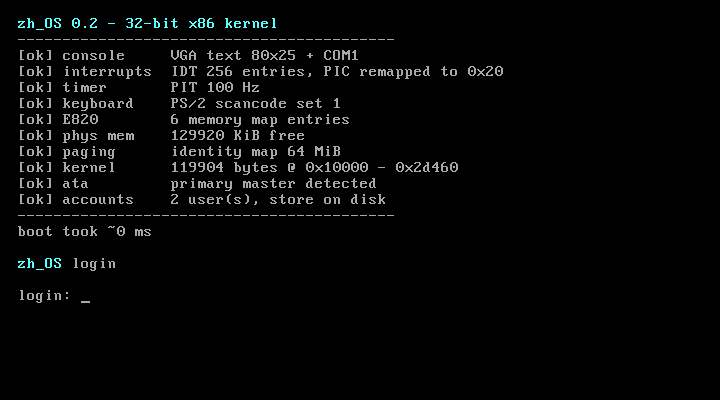
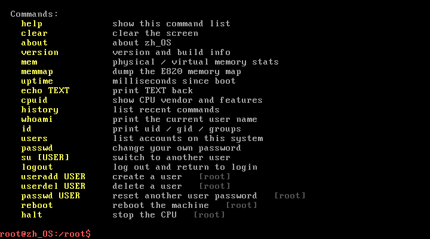

# zh_OS 0.1beta

一个从零开始写的 **32 位 x86 教学内核**：自带两阶段引导、C 语言内核、物理内存管理、分页、
ATA 磁盘驱动、**Linux 风格的账户与登录系统**，以及交互式 shell。
不依赖任何现成操作系统，双击两个 `.bat` 就能编译、制作镜像并在虚拟机里跑起来。





---

## 特性

| 模块 | 说明 |
| --- | --- |
| 引导 | 两阶段引导：512 字节 MBR + 4 KiB stage2，BIOS EDD 读盘，切换 32 位保护模式 |
| 内核 | freestanding C（无 libc），链接到物理地址 `0x10000` |
| 描述符 | GDT（内核/用户代码段、数据段）、IDT 256 项 |
| 中断 | 32 个 CPU 异常 + 16 个硬件中断，8259A PIC 重映射到 `0x20` |
| 定时器 | 8253/8254 PIT，100 Hz，提供 tick 与 uptime |
| 键盘 | PS/2 扫描码集 1，支持 Shift / Caps Lock，扩展键转义序列 |
| 内存 | BIOS E820 内存布局解析 + 位图物理页分配器 |
| 分页 | 32 位两级页表，恒等映射 64 MiB |
| 磁盘 | ATA PIO 驱动，28 位 LBA 单扇区读写，可真正掉电保存数据 |
| 密码学 | SHA-256（FIPS 180-4 全向量通过）+ 每用户随机盐 + 1000 轮迭代 |
| 账户 | Linux 风格 uid/gid、家目录、登录 shell，双槽原子写入防掉电损坏 |
| 登录 | `login:` 提示、口令隐藏回显、失败延迟、三次失败锁定 |
| Shell | 21 条命令，命令历史、权限分级、Linux 风格提示符 |

---

## 快速开始

### 1. 准备工具

需要以下三样东西（Windows 10/11）：

| 工具 | 用途 | 安装方式 |
| --- | --- | --- |
| **LLVM**（clang / ld.lld / llvm-objcopy） | 编译并链接内核 | `winget install LLVM.LLVM` |
| **NASM** | 汇编引导程序与中断入口 | 脚本会自动下载到 `tools\nasm` |
| **QEMU** | 运行虚拟机 | `winget install SoftwareFreedomConservancy.QEMU` |

一条命令自动准备（会下载 NASM 到项目内，不污染系统）：

```bat
powershell -NoProfile -ExecutionPolicy Bypass -File scripts\get-tools.ps1
```

### 2. 一键制作镜像

```bat
make_image.bat
```

输出：

```
build\zh_OS.img     32 MiB 原始硬盘镜像 (MBR 分区表, QEMU 用)
build\zh_OS.vdi     2 MiB VirtualBox 原生格式
build\zh_OS.vmdk    VMware / VirtualBox 通用格式
build\kernel.elf    带符号的内核, 方便 objdump / gdb
```

### 3. 一键启动虚拟机

```bat
run_vm.bat
```

镜像不存在时会自动先制作。虚拟机窗口打开后，用 `root` / `root` 或 `guest` / `guest` 登录，
然后输入 `help` 查看命令。

> 登录后建议立刻执行 `passwd` 修改默认密码。

---

## 账户系统

启动后会先进入登录界面，默认有两个账户：

| 用户 | 密码 | uid | gid | 家目录 | 说明 |
| --- | --- | --- | --- | --- | --- |
| `root` | `root` | 0 | 0 | `/root` | 超级用户，可管理账户 |
| `guest` | `guest` | 1000 | 100 | `/home/guest` | 普通用户 |

> 首次启动时会自动创建这两个账户并写入磁盘。**请登录后立刻用 `passwd` 修改密码。**

### 与 Linux 的对应关系

| Linux | zh_OS |
| --- | --- |
| `/etc/passwd` 的 uid/gid/home/shell 字段 | `struct user_account` 同名字段 |
| `/etc/shadow` 的口令摘要 | `password_hash` + `salt` + `rounds` |
| `crypt(3)` + salt | SHA-256(盐 ‖ 口令) 迭代 1000 轮 |
| `login` / `su` / `passwd` / `useradd` / `userdel` | 同名 shell 命令 |
| 提示符 `user@host:dir$`，root 用 `#` | `user@zh_OS:home$`，root 用红色提示符 |

### 口令安全设计

- **不保存明文**：只存 `SHA-256` 摘要。
- **每用户独立随机盐**：16 字节，来自 TSC 混合，避免相同口令产生相同摘要。
- **迭代 1000 轮**：抬高暴力破解成本（QEMU 上约 0.1 秒/次）。
- **失败延迟 400 ms + 三次锁定**：登录失败会被放慢，连续 3 次失败则停住。
- **口令策略**：至少 4 位、必须同时包含字母和数字、不能与用户名相同。
- **改密码需验旧密码**：非 root 用户改自己的口令必须先通过验证。

### 掉电安全

账户库写在磁盘 **LBA 4096 / 4097** 两个扇区，交替写入：

```
写入前:  [槽A: seq=5, 有效]  [槽B: seq=4, 有效]
写入后:  [槽A: seq=5, 有效]  [槽B: seq=6, 最新]   <- 下次从 B 读取
```

新数据总是写进"非当前"的槽，写完再刷新磁盘。任何时刻至少有一个完整副本，
因此写到一半断电也不会丢掉全部账户。读取时用 CRC32 校验，两槽都有效则取序号大的。

---

## 命令列表

### 通用命令（所有用户）

| 命令 | 说明 |
| --- | --- |
| `help` / `?` | 显示所有命令（root 专用命令会标注 `[root]`） |
| `clear` / `cls` | 清屏 |
| `about` | 关于 zh_OS |
| `version` / `ver` | 版本、编译时间、账户存储位置 |
| `mem` | 物理内存与分页统计 |
| `memmap` | 打印 E820 内存布局 |
| `uptime` | 系统已运行毫秒数 |
| `echo TEXT` | 回显文本 |
| `cpuid` | CPU 厂商、型号与特性 |
| `history` | 最近输入的命令 |
| `whoami` | 当前用户名 |
| `id` | 当前 uid / gid / 所属组 |
| `users` | 列出所有账户 |
| `passwd` | 修改自己的密码（需先验证旧密码） |
| `su [USER]` | 切换到其他用户（默认 root） |
| `logout` / `exit` | 登出并回到登录界面 |

### 仅 root 可用

| 命令 | 说明 |
| --- | --- |
| `useradd USER` | 创建用户（交互式设置密码，uid 自动分配） |
| `userdel USER` | 删除用户（不能删 root，不能删自己） |
| `passwd USER` | 重置其他用户的密码 |
| `reboot` | 重启（窗口保持打开） |
| `halt` / `shutdown` | 停止 CPU |

完整说明见 [命令列表.txt](命令列表.txt)。


---

## 脚本说明

| 脚本 | 作用 |
| --- | --- |
| `make_image.bat` | 编译 + 打包镜像 + 生成 VDI/VMDK（**最常用**） |
| `run_vm.bat` | 用 QEMU 启动，镜像缺失时自动制作 |
| `vbox.bat` | 创建 VirtualBox 虚拟机并使用 `.vdi` |
| `build.bat` | 只编译，不打包镜像 |
| `make_image.bat debug` | `-O0 -g` 调试构建 |
| `make_image.bat clean` | 删除 `build` 目录 |
| `run_vm.bat serial` | 无窗口，串口输出直接打到控制台 |
| `run_vm.bat debug` | 额外记录 QEMU 中断/CPU 日志到 `build\logs`（此模式下 `reboot` 会关闭窗口） |

`scripts\` 下是这些 bat 实际调用的 PowerShell 脚本，可以单独运行：

| 脚本 | 作用 |
| --- | --- |
| `find-tools.ps1` | 查找工具链，输出 JSON（支持 `CLANG_PATH`、`NASM_PATH`、`QEMU_PATH` 环境变量） |
| `check-tools.ps1` | 检查构建工具是否齐全 |
| `get-tools.ps1` | 下载 NASM 并检查其余工具 |
| `build.ps1` | 汇编 + 编译 + 链接 |
| `mkimage.ps1` | 把 boot / stage2 / kernel 拼成 raw 镜像 |
| `mkdisks.ps1` | raw 转 VDI + VMDK |
| `vbox-create.ps1` | 创建/更新 VirtualBox 虚拟机 |
| `get-tool-path.ps1` | 输出单个工具路径，供 bat 使用 |
| `ppm2png.ps1` | QEMU 截图 PPM 转 PNG（文档用） |

---

## 目录结构

```
zh_OS/
├── boot/
│   ├── boot.asm          MBR: 读入 stage2 并跳转
│   └── stage2.asm        E820 / A20 / 读内核 / 进保护模式
├── kernel/
│   ├── main.c            kmain: 初始化顺序、启动信息、登录循环
│   ├── shell.c           交互式 shell（命令、权限、会话）
│   ├── linker.ld         链接脚本 (0x10000)
│   ├── arch/
│   │   ├── entry.asm     _start、GDT/IDT 装载、中断桩
│   │   ├── descriptors.c GDT 与 IDT
│   │   └── interrupt.c   PIC 重映射与中断分发
│   ├── auth/
│   │   ├── user.c        账户库、口令派生、磁盘持久化、会话
│   │   └── login.c       登录界面与口令验证流程
│   ├── drivers/
│   │   ├── console.c     VGA 文本 + COM1
│   │   ├── keyboard.c    PS/2 键盘
│   │   ├── timer.c       PIT 100 Hz
│   │   └── ata.c         ATA PIO 磁盘读写
│   ├── mm/
│   │   ├── pmm.c         位图物理页分配器
│   │   └── paging.c      两级页表
│   ├── lib/
│   │   ├── string.c      memset/memcpy/str*/itoa
│   │   ├── printf.c      kprintf / kpanic
│   │   ├── sha256.c      SHA-256 (FIPS 180-4)
│   │   └── line.c        行输入（支持口令隐藏回显）
│   └── include/          头文件
├── scripts/              构建脚本 (PowerShell)
├── docs/                 截图
├── make_image.bat        一键制作镜像
├── run_vm.bat            用 QEMU 启动
├── vbox.bat              创建/启动 VirtualBox 虚拟机
├── build.bat             只编译
├── 命令列表.txt           shell 命令速查
├── LICENSE               MIT
└── README.md
```

---

## 构建流程

```
boot.asm   ──nasm──>  boot.bin    (512 B)   → 镜像偏移 0
stage2.asm ──nasm──>  stage2.bin  (4 KiB)   → 镜像偏移 512
kernel/*.c ─clang──>  *.o ┐
entry.asm  ─nasm──>  *.o ─┴─ld.lld─> kernel.elf ─objcopy─> kernel.bin
                                                        → 镜像偏移 1 MiB
```

镜像布局：

```
LBA 0        引导扇区 + 分区表 (0x55AA)
LBA 1..8     stage2
LBA 2048     内核平铺二进制 (加载到 0x10000)
LBA 4096     账户库槽 A
LBA 4097     账户库槽 B
```

> 账户库固定占用 LBA 4096 和 4097，远离内核区，重建镜像不会覆盖。
> 但 `make_image.bat` 每次都会生成全新的空白镜像，**账户会一起被清空**。
> 想保留账户，请备份 `build\zh_OS.img`，或直接重复使用同一个镜像文件。

---

## 在其他虚拟机里使用

`make_image.bat` 会同时产出三种格式：

```
build\zh_OS.img     QEMU / 通用 raw 镜像
build\zh_OS.vdi     VirtualBox 原生格式
build\zh_OS.vmdk    VMware / VirtualBox 通用格式
```

> **VirtualBox 不能直接挂载 raw `.img`**（会把它判定成软盘而拒绝），
> 必须用 `.vdi` 或 `.vmdk`。

### VirtualBox（推荐用一键脚本）

```bat
vbox.bat
```

脚本会创建名为 `zh_OS` 的虚拟机、挂载 `build\zh_OS.vdi`、然后打开 VirtualBox 管理器，
双击 `zh_OS` 启动即可。

| 命令 | 作用 |
| --- | --- |
| `vbox.bat` | 创建/更新虚拟机并打开管理器 |
| `vbox.bat run` | 创建/更新虚拟机并直接启动 |
| `vbox.bat recreate` | 重建镜像 + 删除旧虚拟机重新创建 |

**手动创建步骤：**

1. VirtualBox 管理器 → 新建
2. 名称 `zh_OS`，类型 **Other**，版本 **Other/Unknown (32-bit)**
3. 内存 **128 MiB**
4. 硬盘 → **使用已有的虚拟硬盘文件** → 选择 `build\zh_OS.vdi`
5. 设置 → 系统 → 启动顺序：只勾选 **硬盘**
6. 启动

**关于磁盘 UUID：** VirtualBox 会把每个磁盘的 UUID 记在媒体注册表里。
重新运行 `make_image.bat` 后 VDI 的 UUID 变了，旧虚拟机会报 *inaccessible*。
此时用 `vbox.bat recreate` 重建虚拟机即可，脚本会自动处理。

### QEMU

```bat
run_vm.bat
```

或手动：

```bat
qemu-system-i386 -drive file=build/zh_OS.img,format=raw,if=ide,index=0 -m 128
```

### VMware

1. 新建虚拟机 → 自定义 → 其他 32 位
2. 磁盘选择「使用现有虚拟磁盘」，指向 `build\zh_OS.vmdk`

---

## VirtualBox 启动失败的排查

如果点启动后立刻报错，按下面的顺序检查。

### 错误 1：`VT-x is not available (VERR_VMX_NO_VMX)`

原因：VirtualBox 拿不到 CPU 虚拟化能力。常见于下面两种情况。

**情况 A：BIOS/UEFI 里没开虚拟化**

重启进 BIOS，找 `Intel VT-x` / `Intel Virtualization Technology` / `SVM Mode`（AMD）并启用。

**情况 B：Windows 的 Hyper-V / VBS 占着虚拟化层**

症状：任务管理器显示「虚拟化: 已启用」，但 VirtualBox 仍报 `VERR_VMX_NO_VMX`，
同时还有 `WHvCapabilityCodeHypervisorPresent is FALSE`。

这说明 Windows 已经用 Hyper-V 层启动了（VBS / 内存完整性 / WSL2 / Docker 都会这样），
但 **Windows Hypervisor Platform（WHP）** 这个让第三方虚拟机软件借用 Hyper-V 的功能没开。

解决（**管理员 PowerShell**，然后重启）：

```powershell
# 开启 Windows 虚拟机监控程序平台，让 VirtualBox 能借用 Hyper-V
Enable-WindowsOptionalFeature -Online -FeatureName HypervisorPlatform -All

# 如果你不用 Hyper-V / WSL2 / Docker，也可以彻底关掉 Hyper-V
# bcdedit /set hypervisorlaunchtype off
```

开启 `HypervisorPlatform` 后重启，VirtualBox 就能正常启动。

### 错误 2：`inaccessible` / `UUID does not match`

VDI 被重建过。执行：

```bat
vbox.bat recreate
```

### 错误 3：`can't be used as the requested device type (HDD, detected floppy)`

你直接挂了 `build\zh_OS.img`。改用 `build\zh_OS.vdi`。

### 错误 4：黑屏，卡在 bootloader

确认启动顺序里「硬盘」排在第一位，且没有接光驱。

---

## 调试

- **串口日志**：`build\logs\serial.log`，内核所有输出都会镜像到这里
- **QEMU 日志**：`run_vm.bat debug` 会额外写 `build\logs\qemu-debug.log`
- **符号**：`build\kernel.elf` 带符号表
  ```bat
  llvm-objdump -d build\kernel.elf | more
  llvm-nm -n build\kernel.elf
  ```
- **单步调试**：
  ```bat
  qemu-system-i386 -drive file=build/zh_OS.img,format=raw -s -S -m 128
  gdb -ex "target remote :1234" -ex "file build/kernel.elf"
  ```

---

## 已知限制

- 只支持 **32 位 x86**，没有 PAE / 长模式
- **账户系统不是内核安全边界**：没有用户态和地址空间隔离，进程始终运行在 ring 0。
  越权检查发生在命令分发层，属于"礼貌性"权限控制，挡不住恶意代码。
  但口令存储（加盐 + 迭代哈希）是真实有效的。
- 单核、无进程调度（shell 在内核态运行）
- 没有文件系统；账户库直接写在固定的两个扇区上，不是文件
- 没有 `sudo`、用户组管理、密码过期策略、登录审计日志
- 口令派生用 1000 轮迭代，比 /etc/shadow 的 crypt 弱，仅适合教学
- VGA 文本模式只有 ASCII，所以内核界面是英文
- 恒等映射上限 64 MiB；超过的内存能被 E820 看到，但不会被映射
- 磁盘不可写时（例如用 CD-ROM 启动）会退化为免登录的 root 单用户模式

---

## 下一步可以做什么

- [ ] 用户态 + TSS + `int 0x80` 系统调用（让权限检查真正成为安全边界）
- [ ] 抢占式调度器与多任务
- [ ] 简单文件系统（FAT12 或自研只读 FS），把账户库改成 `/etc/passwd`
- [ ] 堆分配器 (`kmalloc` / `kfree`)
- [ ] `sudo` 与用户组（`/etc/group`）
- [ ] 登录失败审计日志与锁定策略
- [ ] 加载 ELF 格式的内核模块
- [ ] PS/2 鼠标

---

## 许可证

[MIT](LICENSE)
